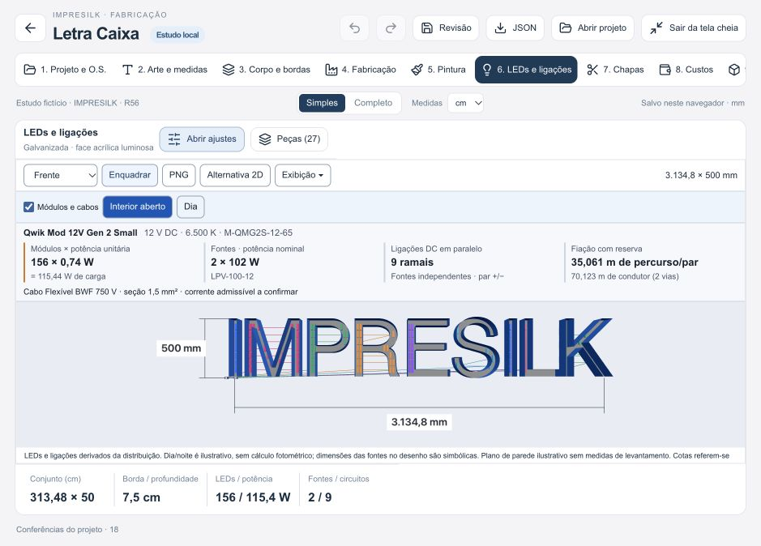
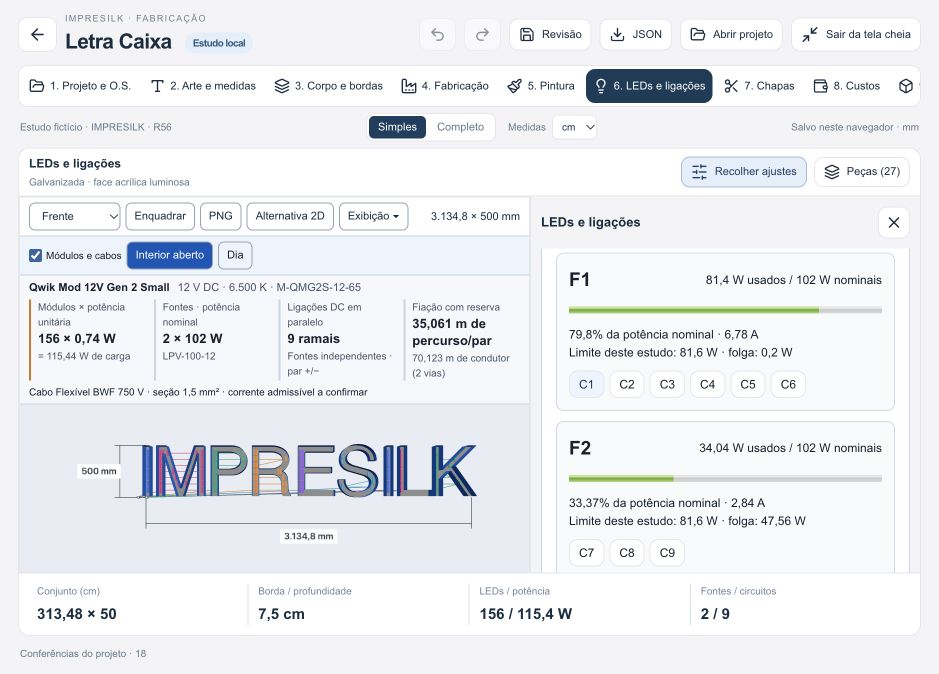

# Letra Caixa — LEDs, fontes e fios v4

Entrega local em 17/10/2026. Sem publicação, escrita no ERP ou alteração do ACM nesta rodada.

Prévia: http://127.0.0.1:4315/revisao-local.html#/ferramenta-ia?ferramenta=letra-caixa

## Componentes reais e preenchimento

- Principal Sloan Qwik Mod 12V Gen 2 Small, Medium e Large, variantes 6500 K, com SKU, potência, dimensões, IP, revisão e link da ficha. Conferida a revisão F de 12/10/2026, diferente da busca indexada anterior.
- MEAN WELL LPV-60-12 (60 W / 5 A) e LPV-100-12 (102 W / 8,5 A); uma saída física DC por fonte.
- Corfio BWF 750 V de 0,75 / 1,5 / 2,5 mm², com resistência máxima por condutor a 20 °C; capacidade de corrente permanece pendente das condições de instalação.
- Escolher um componente preenche dados nominais. Alterações posteriores são identificadas na interface e nos documentos. A orientação horizontal/vertical conserva as dimensões da ficha.
- Espaçamentos oficiais por profundidade ficam consultáveis e são aplicados somente por ação explícita, sem interpolação nem promessa fotométrica. Um ajuste separado de malha evita sobreposição sem alegar densidade luminosa validada.

Fontes: [pesquisa de LEDs](pesquisa-leds-v4.md) e [pesquisa de fontes/fios](pesquisa-fontes-fios-v4.md).

## Cálculos e apresentação

A quantidade é a dos módulos efetivamente posicionados dentro dos contornos e vazados. Potência = quantidade × W/módulo; corrente nominal = potência / tensão. Cabimento inclui largura, orientação e espessura física conhecida do LED dentro da cavidade da letra.

O limite por ramal é distinto do limite de potência da fonte. Distribuição externa permite várias derivações em uma única saída DC, sem ligar fontes entre si. O número de ramais externos e a margem de carga são premissas editáveis do estudo, não características presumidas do fabricante.

A interface mostra fontes alocadas, potência nominal, carga, corrente, porcentagem utilizada, limite do estudo, folga, ramais e o mínimo teórico apenas por potência. A alocação é determinística; não promete otimização global.

Esquema didático mostra módulos em paralelo. Selecionar um ramal destaca seus módulos e fios no mapa 2D. A cena 3D mantém um resumo de módulos, potência, fontes, ramais e metragem, inclusive em celular.

Cabos são separados em alimentação fonte → primeiro módulo, interligações e reserva. Metros de percurso do par não são somados aos metros dos condutores: dois condutores avulsos correspondem ao dobro do percurso. A queda calculada considera ida/retorno e a corrente dos módulos a jusante de cada segmento.

## Documentos e persistência

CSV, SVG e caderno HTML/PDF usam a mesma revisão calculada. Caderno e CSV identificam fabricante, SKU, CCT, IP e situação dos valores de catálogo. Incluem fontes, ramais, percursos e quantitativos; resistência é preservada sem arredondar 0,0133 para 0,013.

Projetos anteriores continuam aceitos. Troca de especificação da fonte invalida a confirmação anterior das condições. Avisos de erro de salvamento deixam de aparecer quando a revisão corrigida é salva, sem apagar outros avisos.

## Verificação

- 1.046 testes de regressão aprovados, incluindo 32 do motor de distribuição LED, 11 de catálogo e testes de documentos/proveniência e edição de confirmação.
- Suíte focada final: 159 testes de Letras/Fabricação aprovados (subconjunto, não somar).
- ESLint sem erros; permanece o aviso anterior em Agenda.jsx.
- Builds de produção e revisão concluídos; permanecem avisos de tamanho dos pacotes Three.js/fontes tipográficas.
- Navegador: seleção dos três grupos de catálogo, orientação vertical, malha, troca de fonte 60 → 102 W, atualização por tamanho do conjunto, ramal em destaque, edição que remove a confirmação, queda acima do limite bloqueando exportação, desfazer e reabertura com dados preservados.
- Exportados CSV, SVG e caderno; prévia do caderno conferida para SKU, fonte, resistência, saída física, quantidade e condutores.
- Desktop e celular 390 × 844: sem transbordamento horizontal do documento ou dos indicadores elétricos; console sem erros durante a conferência final.

Estudo fictício conferido na tela: 156 módulos Small × 0,74 W = 115,44 W / 9,62 A, 9 ramais; 3 fontes de 60 W ou 2 de 102 W sob margem configurada de 80%. Não constitui recomendação de densidade óptica ou aprovação da fabricação.

## Limites mantidos explícitos

- Não comprova estoque, fornecimento no Brasil ou aprovação da combinação LED/fonte.
- Malha geométrica não é fotometria, teste de uniformidade ou garantia de iluminação de todo o contorno.
- Metragem bruta DC não desconta chicotes de fábrica, não inclui alimentação AC nem comprova quantidade de compra.
- A queda usa o condutor cadastrado; resistências desconhecidas dos chicotes, conectores e temperaturas reais não são adicionadas. Não aprova a queda total da instalação.
- Bitola, corrente admissível, bornes, proteções, ambiente, curvas de redução de carga e instalação permanecem para conferência do responsável.
- Gabinetes das fontes e seus afastamentos na cena são simbólicos; os LEDs usam dimensões físicas conhecidas.
- Arquivos são locais e não foram anexados à O.S. remota.

