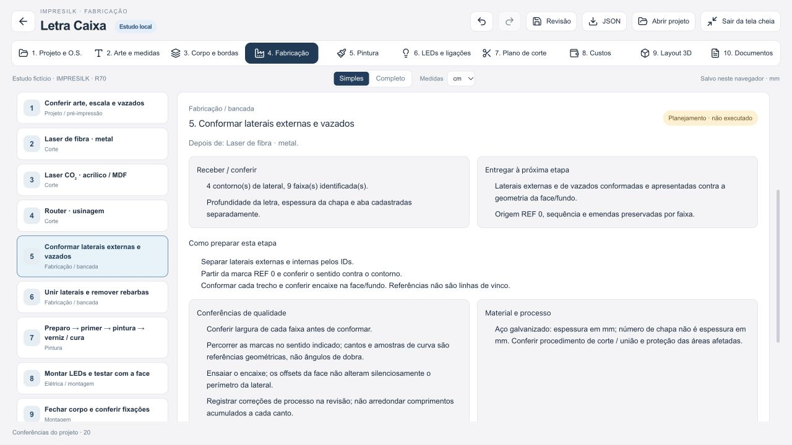
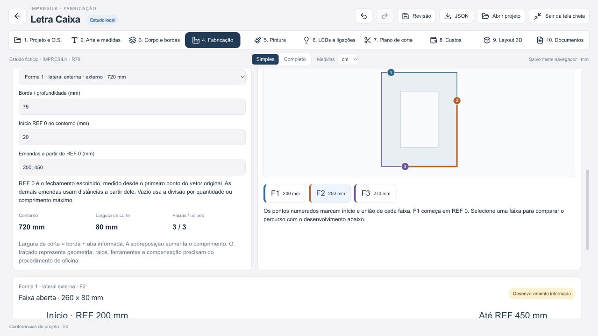
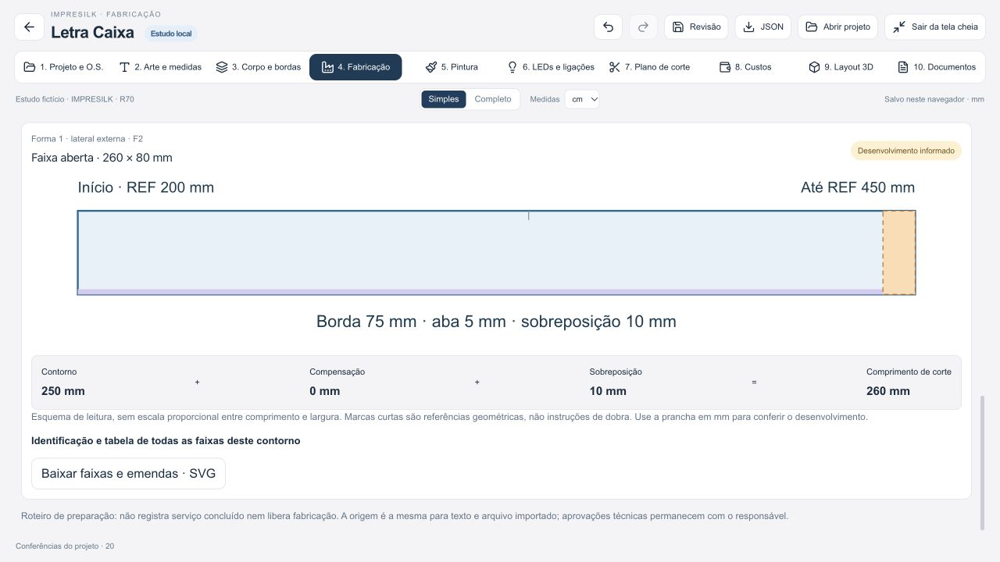

# Letra Caixa · fabricação v5

Entrega local para revisão em 18/10/2026. Escopo: processos de fabricação, bordas, emendas e plano de corte, inclusive a partir de vetores importados. Sem publicação, alterações no ERP ou registros reais. Recursos de LEDs v4 e ACM preservados.

Prévia: http://127.0.0.1:4315/revisao-local.html#/ferramenta-ia?ferramenta=letra-caixa

## Como usar

1. Em **Arte e medidas**, digite o texto ou importe SVG/DXF. Confirme a escala física e os contornos. Há um exemplo fictício para baixar no próprio importador.
2. Defina o modelo, os materiais e a profundidade em **Corpo e bordas**.
3. Em **Fabricação → Etapas de fabricação**, escolha cada operação para ver o que deve receber, preparar, conferir e entregar. O roteiro muda conforme a composição: metal no laser de fibra; acrílico/MDF no CO₂; PVC no router. Processos independentes não são tratados como uma sequência obrigatória entre máquinas.
4. Em **Bordas e emendas**, informe união, sobreposição, limite de comprimento e aba/compensação quando houver procedimento. Selecione a lateral externa ou a de um vazado. Defina a origem REF 0 e as distâncias das emendas. Escolha F1/F2/F3 para relacionar o percurso colorido à faixa aberta.
5. Em **Plano de corte**, filtre o material/processo, selecione uma chapa e confira as peças. O mesmo plano está na etapa principal 7, com acesso aos formatos, refilos e separações.
6. Baixe a prancha da etapa, as faixas em SVG, o SVG de cada chapa ou o **Caderno de fabricação**. O caderno HTML reúne o roteiro e as chapas e pode ser impresso em PDF. Os documentos ficam arquivados localmente por revisão; não são anexados automaticamente à O.S.

## O que mudou

- Roteiro detalhado da conferência da arte até instalação, com entradas, resultados esperados, operações, verificações de qualidade e notas específicas do material.
- Visão da lateral externa e de cada vazado, com sentido de percurso, origem, emendas e faixas identificadas.
- Separação entre **profundidade da borda**, **aba de união**, **sobreposição da emenda** e **compensação informada**. O desenho apresenta os termos da conta, sem criar valores técnicos ausentes.
- Reconciliação dos comprimentos: a soma dos trechos nominais deve reproduzir o contorno. Marcas geométricas não são instruções de dobra.
- Plano por material, espessura, lote, acabamento, direção e processo. Desenha contornos reais e vazados dentro dos envelopes, com seleção vinculada à lista.
- SVG com camadas de corte nominal, envelopes, referências e anotações separadas. Os textos e as emendas não viram cortes.
- Proteção contra reaproveitar posições de emenda antigas quando o usuário troca ou redimensiona uma arte, inclusive quando os IDs das formas coincidem.
- Durante recálculo, os campos dependentes do contorno e a exportação aguardam a revisão atual. Profundidade continua editável quando há geometria inválida; erros de origem/emenda têm ação de recuperação.

## Exemplo fictício conferido no navegador

Arquivo `public/examples/letras-fabricacao-v5.svg`, 340 × 200 mm: três formas e um vazado. Configuração de teste, sem equivalência a procedimento aprovado: profundidade 75 mm, aba 5 mm, sobreposição 10 mm, compensação informada de 0 mm, faixa máxima 300 mm.

No contorno externo de 720 mm, REF 0 a 20 mm do início original e emendas a 200 e 450 mm dessa origem resultaram em trechos nominais de 200, 250 e 270 mm. Com a sobreposição, as faixas medem 210, 260 e 280 × 80 mm. O conjunto gerou quatro contornos laterais, nove faixas, 2.050 mm desenvolvidos e três chapas por material/processo, com 15 peças alocadas e nenhuma sem espaço.

Foram conferidos: importação/aplicação, emenda manual, seleção da faixa, material/processo da chapa, downloads reais de SVG e caderno, persistência após recarga e reinicialização das referências ao redimensionar a arte. O exemplo é apenas para estudar o comportamento da ferramenta.

## Verificação

- 1.071 testes passaram, zero falhas ou testes ignorados: motores ACM/letras, fabricação, importação, corte, salvamento/revisões, cálculos, acesso e backend compartilhado.
- Revisão independente: 22 testes focados também passaram; não são somados ao total acima.
- Lint: zero erros; um aviso preexistente em `src/pages/Agenda.jsx`.
- Builds de produção e revisão local concluídos. Permanece aviso de tamanho dos módulos Letra Caixa/Three.js, sem bloqueio da compilação.
- Interface desktop e largura 390 px conferidas, sem transbordamento horizontal do documento. Desenhos e tabelas extensos mantêm sua rolagem local.
- Console do navegador sem erros durante a conferência final. SVGs baixados são XML válido e declaram dimensões em mm; caderno baixado contém roteiro, arte, revisão e as três chapas.
- `git diff --check` sem problemas de espaço em branco.

## Limites técnicos explícitos

- O encaixe utiliza envelopes retangulares conservadores. Não aproveita espaços entre curvas nem vazados para encaixar outras peças. Área fora de envelopes não equivale a retalho fisicamente recuperado.
- Curvas importadas ainda são aproximadas por segmentos; não há certificação de tolerância CAD/CAM. Conferir no software de fabricação antes de liberar o corte.
- O desenvolvimento utiliza parâmetros informados. Raios, compensação por dobra, alívios, kerf, sequência de usinagem e pós-processador CNC não são inventados ou certificados pelo desenho.
- Sem compensação informada, as faixas ficam nominais e são identificadas como pendentes. Compensação total não permite deduzir posições corretas de dobra.
- Pintura, união, elétrica e fixação dependem dos procedimentos e componentes reais aprovados. O roteiro não marca execução concluída nem libera produção.
- Salvar no navegador ou baixar arquivo não é backup remoto. A impressão do caderno ajustada à página não mantém escala 1:1.

Pesquisa e referências técnicas: [pesquisa-fabricacao-v5.md](pesquisa-fabricacao-v5.md).

## Capturas da prévia

