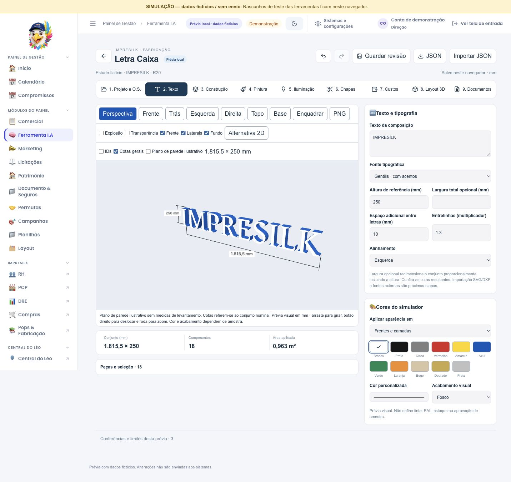
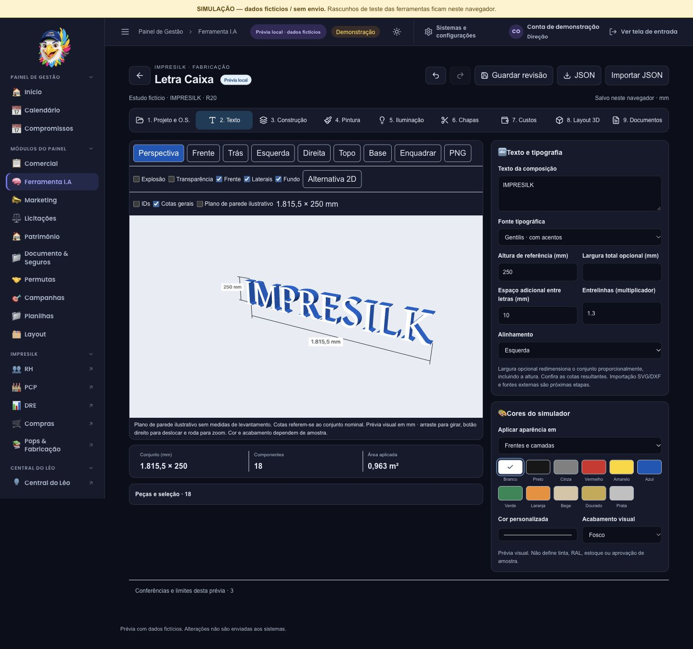

> Atualização de preenchimento e referências: [entrega v3](entrega-v3.md).

# Letra Caixa — primeira prévia local

Registro histórico. O estado atual está em [Entrega v2](entrega-v2.md).

Data: 17/10/2026. Estado: implementação incremental local, sem publicação. Dados de demonstração fictícios.

Prévia: http://127.0.0.1:4315/revisao-local.html#/ferramenta-ia?ferramenta=letra-caixa

Código: `/tmp/painel-letra-caixa-20261017`, ramo `codex/letra-caixa-20261017`. Partiu da prévia ACM v2 de `/tmp/painel-acm-studio-20261017`, que foi preservada. A pasta temporária e o armazenamento no navegador não substituem uma cópia externa.

## O que pode ser experimentado

- Entrada Letra Caixa ao lado do ACM Studio, nove etapas e cards recolhíveis. Layout 3D permanece penúltimo; Documentos é a última etapa.
- Texto com duas fontes locais, acentos conforme a fonte, contornos externos e vazados, dimensão total opcional e espaçamentos. Falta de glifo é apontada, sem substituição silenciosa.
- Letras planas e camadas de MDF, acrílico e PVC; caixa galvanizada nominal com face acrílica ou cega. As camadas da família plana usam o mesmo tipo de material, com espessuras próprias.
- Cores por frente, lateral, fundo, cenário ou componente, acabamento visual, câmera, vistas, seleção, explosão, transparência, cotas gerais, PNG e alternativa 2D.
- Pintura: componentes a pintar, preparo, fundo/primer, tinta e verniz, fabricante/SKU/ficha, código físico, demãos, rendimento, perdas, mistura e tempos informados. Tempo decorrido não libera cura automaticamente.
- Elétrica: cadastro manual de modelos LED, módulos, fontes, circuitos e trechos; potência, corrente, capacidade útil declarada, metros de cabo e condutores e queda de tensão por trecho conforme entradas. Valores desconhecidos permanecem pendentes.
- Aproveitamento por envelopes retangulares, agrupado por material e espessura, sem encaixe entre curvas. Área física e ocupação dos envelopes têm bases distintas. Preços ausentes não viram zero; compra de chapas e consumo de retalhos são separados.
- Planejamento de instalação reutilizado do ACM: medidas em m/cm, centralização ou posição manual, desenho arrastável, recuos/alturas, fotos, recursos de acesso, suportes/fixadores/adesivos, pendências e confirmações por responsável.
- O.S. existente como referência identificada por empresa/ID/número. Na prévia a busca utiliza a fonte fictícia; não grava no ERP nem anexa documentos remotamente.
- Desfazer/refazer, salvamento IndexedDB por usuário/produto, revisões imutáveis, restauração, JSON de projeto e documentos vinculados à revisão.
- SVG e DXF nominais, CSV, molde vetorial de posição com régua e caderno HTML por setores. O HTML pode ser impresso/salvo como PDF pelo navegador; não é geração nativa de PDF nem garantia de impressão 1:1.

## Núcleo compartilhado e preservação do ACM

Foram extraídos backend IndexedDB e primitivas de visualização (coordenadas, formas, extrusão, câmeras, materiais e descarte). O novo produto reutiliza o encaixe conservador e o planejamento da instalação. O motor de bandejas, frisos em V, alívios e demais regras ACM permanece separado do motor de letras.

As quatro adaptações em arquivos ACM são `viewportGeometry.mjs`, `ACMViewport.jsx`, `InstallationPlanner.jsx` e `storage.mjs`. Banco/namespaces e contratos anteriores do ACM foram mantidos. Mudanças de servidor existentes neste clone foram herdadas da prévia ACM; esta entrega não as publicou.

## Cobertura da especificação

| Frente | Estado nesta entrega | Ainda necessário |
|---|---|---|
| Núcleo comum | Backend de persistência, primitivas 3D e reutilização de instalação/encaixe | Expandir o contrato comum sem tornar as regras dos produtos intercambiáveis |
| Texto e letras planas | Fontes locais, contornos, camadas, unidades e quantitativos nominais | Importação SVG/DXF segura, upload de fontes e tolerância geométrica de fabricação |
| Caixa metálica | Face/corpo, profundidade, perímetros e faixas nominais externas/internas | Emendas, sobreposição, offsets, curvas/dobras e compensações calibradas pela oficina |
| Pintura e iluminação | Cards e cálculos determinísticos com dados fornecidos | Cadastro real de produtos, distribuição óptica dos LEDs, topologia completa de alimentação e conferência de instalação elétrica |
| O.S. e instalação | Referência à O.S., planejamento e ficha | Vínculo por item/local, anexação remota, pontos de fixação ligados à geometria e molde paginado |
| Retroiluminada e ACM frisado | Opções identificadas como ainda não modeladas | Motores específicos, materiais e processos validados; não geram componentes fabricáveis nesta versão |

Não há provedor de IA ativo, aprovação automática de fabricação, dimensionamento estrutural, recomendação automática de escada, pós-processador CNC ou integração remota validada nesta entrega. A aplicação funciona com cálculos locais. A prévia não equivale à execução completa das etapas futuras do prompt.

## Evidências da verificação

- Suíte conjunta: **937 testes**, abrangendo ACM, letras, núcleo compartilhado, cálculos comerciais, acessos e consulta de O.S. de instalação.
- Revisões independentes do motor e da integração: corrigidos largura física com bearings, entradas inválidas, unidade inconsistente, confirmação indevida de pintura, módulo órfão, assinatura de exportação, relatório de pintura, bases do aproveitamento, custos de retalhos, material nulo na caixa cega, reemissão do caderno e propagação de falha no arquivamento. Relatórios nesta pasta registram os reprodutores e a rechecagem.
- Navegador: letra O solicitada em 200 mm exibiu largura 200 mm; entrada sequencial `1,25` preservada; cor vermelha e Desfazer conferidos; MDF retirou a elétrica aplicável; alternativa 2D abriu.
- O.S. fictícia localizada e vinculada pela interface. Projeto recuperado após recarregar, mantendo texto, largura e revisão.
- Instalação 10 × 4 m / placa 4 × 0,8 m / base 0: laterais 3 m, acima/abaixo 1,6 m e topo 2,4 m. Troca para cm mostrou 80 cm de altura, sem alterar a geometria. Divergência entre dimensões da instalação e geometria do conjunto permanece visível.
- Dois downloads reais de caderno HTML na mesma revisão, com nomes distintos, arquivamento confirmado e arquivos conferidos (27.996 bytes cada). Não contém scripts. Outros formatos foram verificados pelos testes de documentos; não houve validação em máquina/CAD/CAM físico.
- Desktop 1440 px e celular 390 px conferidos. No celular, largura de conteúdo e área útil foram iguais (381 px com barra). Cores corrigidas no tema escuro. Nenhum erro JavaScript observado no navegador ao final. ACM reabriu com seis peças e sua interface original.
- Build de produção e build de revisão concluídos. ESLint sem erros; permanece aviso anterior em `Agenda.jsx`. Os bundles de fontes/Three.js superam 500 kB e são carregados sob demanda; otimização adicional segue pendente.

## Cuidados de uso da prévia

Os arquivos representam estudo nominal. Antes de fabricação, precisam de conferência de escala, tolerância, processo/material, encaixes, instalação e componentes reais. Curvas usam amostragem com 32 subdivisões por curva; ainda falta demonstrar convergência na tolerância exigida pela máquina.

Guardar revisão arquiva no navegador. Exportar JSON preserva o projeto atual, incluindo dados incorporados; não exporta todo o histórico nem o arquivo de documentos. Limites locais: 24 MiB, 50 revisões e 100 documentos por usuário/produto. Nenhuma remoção automática foi implementada.

As próximas etapas técnicas são: importação vetorial e tolerâncias; desenvolvimento compensado das laterais; cadastro real de LED/fontes/tintas; distribuição elétrica/óptica e pontos físicos de fixação; depois retroiluminação e letras ACM. Elas exigem procedimentos e dados técnicos reais para sair de estudo nominal.

## Capturas

